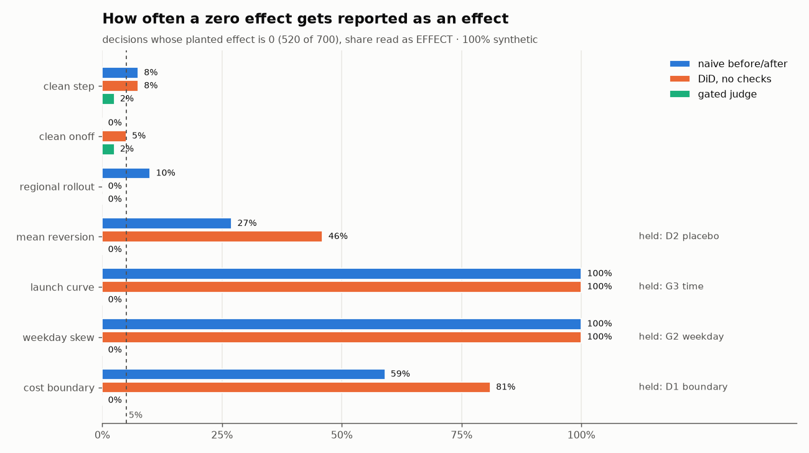
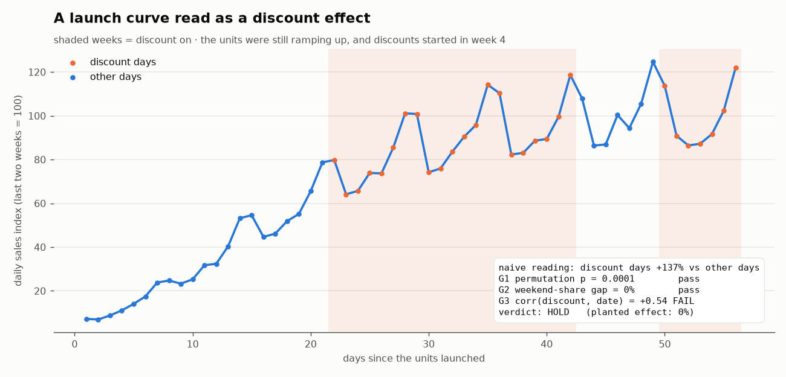

# Decision-Impact Eval

[](https://github.com/cloudavenue0012-creator/decision-impact-eval/actions/workflows/ci.yml)


A review meeting decides to act — a promotion at some stores, an operating change at
others — and a month later someone asks *"did it work?"*. This repo judges that
question **store by store, as a causal claim**, and refuses to call a correlation an
effect. A claim has to clear a fixed set of checks; when it can't, the answer is
**"hold"**, and the eval shows that "hold" is often the correct answer.

> **100% synthetic data.** Stores, regions, calendars, sales and the planted effects are
> all generated (`synth_panel.py`). No company data, names, figures or store counts.
> A portable re-implementation of a store-level effect-measurement practice, built to be
> measured against ground truth.



## Why this exists

A before/after number is easy to produce and hard to trust. Sales move with the
weekday, the season, chain-wide events and the store's own luck, so almost any action
"comes with" a change. In the original setting this repo generalises, one channel showed
**+1645% at p = 0.0001** for a discount — and it was not the discount. The channel had
just launched, discounts happened to run later in its life, and the comparison was
reading the **launch curve**. The two checks in use at the time (significance and
weekday balance) both passed it.

The lesson that became the rule: **systematic is not causal.** A difference that is
systematic — a ramp, a weekday mix, a regional shift — gives an even *smaller* p-value
than a real effect, because it is consistent day after day. The p-value measures how
unlikely the difference is under shuffling, not what caused it.

## The rule: a claim must clear every check

| check | question | holds when |
|---|---|---|
| **D1 boundary** | Does the treated/control line separate what customers experience? | the line is a cost-allocation boundary — the other side is not a control |
| **D2 placebo** | Pretend the action started 14 days early: does the fake action "work"? | placebo p < 0.05 — the treated stores were already moving (regression to the mean, a differential trend) |
| **G2 weekday** | Same weekend share on both sides of the comparison? | gap > 20 pp |
| **G3 time** | Is the action label correlated with the date? | \|corr(action, date)\| > 0.40 |
| **G1 permutation** | Two-sided permutation test, 10,000 shuffles (samples are 20–30 days, so no t-test) | Holm-adjusted p ≥ 0.05 → **no effect** |

G1 is corrected with **Holm inside each review cycle of 10 decisions**: ten honest
"did nothing" decisions at α = 0.05 produce about half a false "effect" per cycle.
The verdict is one of **EFFECT** (size + 95% interval), **NO_EFFECT** (with the
interval), or **HOLD** (and which check stopped it).

Three estimators sit under the checks: **naive** before/after on the treated stores,
**DiD** against concurrent control stores, and a **synthetic control** (non-negative
control-store weights summing to 1, fitted on every day before the action switches on).
The judge reads DiD; the synthetic control is scored for recovery error alongside it.

### Two design choices the numbers forced

**Shuffle the unit that was assigned.** When a control group exists, the action was
assigned to *stores*, so G1 shuffles store labels (each store scored by its own
after-minus-before change). Only when the comparison is inside the same stores — an
action switched on for some days — are day labels shuffled. Shuffling days when stores
were assigned treats a store's temporary slump (road works, a staffing gap) as if it
were the action. Measured on the effect-0 decisions with a control: **4.2% false claims
shuffling stores vs 34.2% shuffling days.**

**G2/G3 are measured on the dates each side is observed.** With a concurrent control
the reference side is the control stores *on the same dates*, so the calendar is
differenced out and G2 = G3 = 0 by construction — that is what a control buys. A
before/after comparison without one has corr(label, date) = 0.87 (28 days against 28):
it is a comparison of two time periods, and G3 says so.

## Results (`eval.py`)

```
 decisions: 700  (true effect 0: 520 | true effect > 0: 180)
 'claimed' = share of decisions read as EFFECT

 scenario          truth         n   naive     DiD   gated    held  blocked by
 clean_step        effect = 0   40   7.5%   7.5%   2.5%   2.5%  D2
 clean_step        effect > 0   60  40.0%  68.3%  55.0%   6.7%  D2
 clean_onoff       effect = 0   40   0.0%   5.0%   2.5%   0.0%  -
 clean_onoff       effect > 0   60  43.3%  96.7%  95.0%   0.0%  -
 regional_rollout  effect = 0   40  10.0%   0.0%   0.0%   5.0%  D2
 regional_rollout  effect > 0   60  58.3%  73.3%  60.0%   1.7%  D2
 mean_reversion    effect = 0  100  27.0%  46.0%   0.0% 100.0%  D2
 launch_curve      effect = 0  100 100.0% 100.0%   0.0% 100.0%  G3
 weekday_skew      effect = 0  100 100.0% 100.0%   0.0% 100.0%  G2
 cost_boundary     effect = 0  100  59.0%  81.0%   0.0% 100.0%  D1
--------------------------------------------------------------------------
 false-claim rate, all effect-0 decisions : naive  56.3%  DiD  63.8%  gated   0.4%
 false-claim rate, honest designs only    : naive   5.8%  DiD   4.2%  gated   1.7%
 catch rate, real effects                 : naive  47.2%  DiD  79.4%  gated  70.0%   (gated held 2.8%)
   gated catch rate by planted effect      : +3-5% 53.8%  +5-7.5% 67.2%  +7.5-10% 85.1%
 recovery error, real effects (pp)        : naive  2.34  DiD  1.59  synth  1.50  gated claims  1.42
 95% interval contains the planted effect : gated claims 100.0% | all real-effect decisions 98.3%
```
*(100 decisions per scenario, `--seed 42`, 10,000 permutations; planted effects are 0 or
+3% to +10%. Numbers vary by seed.)*

- **False claims: 63.8% → 0.4%.** Across every decision whose true effect is zero, an
  ungated DiD calls an effect in nearly two out of three; the gated judge in 2 of 520.
- **The price is small and visible.** The gated judge catches 70.0% of real effects
  against 79.4% for the ungated DiD; the difference is Holm correction plus 2.8% held by
  the placebo. Catch rate climbs with size: 53.8% of +3–5% effects, 85.1% of +7.5–10%.
- **Estimators.** DiD cuts recovery error from 2.34 pp (naive) to 1.59 pp; the
  synthetic control edges it to 1.50 pp. The 95% intervals are slightly conservative
  (98.3% contain the planted effect).

## The traps, one at a time

| trap | what the generator does | naive / DiD claims | stopped by |
|---|---|---|---|
| **mean reversion** | the action goes to the stores whose last two weeks fell furthest below their usual level | 27.0% / 46.0% | D2 placebo (100% held) |
| **launch curve** | newly launched units still ramping up; discounts switched on only after week 3 | 100% / 100% | G3 time (100% held) |
| **weekday skew** | a chain-wide weekend-only action, nothing untreated to compare with | 100% / 100% | G2 weekday (100% held) |
| **cost boundary** | a region on one side of a *cost-allocation* line, with its own demand shift around the same date | 59.0% / 81.0% | D1 boundary (100% held) |

### The launch curve, reproduced



```
 launch curve (100 decisions, true effect 0):
   naive reading: median +156%, median p 0.0001
   G1 p<0.05 100.0% | G2 pass 100.0% | G3 fail 100.0%   |corr(action,date)| min 0.43 median 0.60
   G1 and G2 pass, only G3 stops it: 100.0%
```

All 100 launch-curve decisions are "significant" and weekday-balanced (discounts run in
whole weeks), and all 100 are stopped by G3 alone. The planted discount effect is zero.
This is the original incident in miniature: the two gates that existed passed it, and
the third gate exists because of it.

### The boundary check is a question, not a statistic

D1 reads a field of the decision record: what is the line between treated and control?
No test on the sales data can tell a cost-allocation boundary from a customer-facing one
when the treated region also has its own demand shift — 81.0% of those decisions get an
ungated DiD "effect". The check is a question someone has to answer before the
statistics run, and the eval measures what skipping it costs.

### Multiple comparisons

```
 multiple comparisons, 50 cycles of 10 decisions that all did nothing:
   'effects' per cycle: raw 0.34 -> Holm 0.00   | cycles with >=1: raw 26% -> Holm 0%
```

Ten honest decisions with no effect, read at p < 0.05, put at least one false "effect"
on the table in 26% of review cycles. Holm inside the cycle removes them.

## Honest notes and limits

- **The noise model decides the calibration.** Temporary store slumps are the hardest
  thing in the generator. With them three times as frequent (`--spell-rate 0.015`) the
  gated false-claim rate on honest designs rises from 1.7% to 4.3% and the catch rate on
  real effects drops from 70.0% to 55.5%; day-label shuffling reaches 41.7% false claims.
  The gate holds, but with less room.
- **D2's split matches the "last two weeks" habit.** The placebo starts 14 days early
  because under-performers are usually picked on the last two weeks. A selection rule on a
  different window needs the placebo moved with it.
- **G3 sees assignment timing, not every trend.** With a concurrent control, G3 is 0 by
  construction; a trend specific to the treated stores in an on/off design would get past
  it. D2 covers that case only for before/after designs.
- **Regional rollouts are judged with store labels.** Assignment was really to one
  region out of four, and four units cannot reach p < 0.05 by themselves. The generator
  keeps region-level drift small; with strong regional shocks, store-level shuffling
  would overstate confidence.
- **"Hold" is an answer.** For a chain-wide weekend-only action there is nothing to
  compare against; HOLD is the correct verdict, not a failure of the judge.

## Architecture

```
synth_panel.py ─► store x day panels + planted effect per decision (ground truth, 7 scenarios)
        │
        ▼
    judge.py   ─► naive / DiD / synthetic control
                  D1 boundary → D2 placebo → G2 weekday → G3 time → G1 permutation (+ Holm per cycle)
                  → EFFECT (size, interval) | NO_EFFECT | HOLD (which check)
        │
        ▼
     eval.py   ─► false-claim rate, catch rate, recovery error, coverage, per-trap table,
                  launch-curve reproduction, multiple-comparison cycles   (+ CI gate)
   charts.py   ─► docs/traps.png, docs/launch_curve.png
```

## Run

```bash
pip install -r requirements.txt
pytest -q                                   # unit tests
python synth_panel.py                       # -> data/ground_truth.csv + one example panel per scenario
python eval.py                              # full eval (700 decisions, 10,000 permutations each)
python charts.py                            # -> docs/traps.png, docs/launch_curve.png (reads data/verdicts.csv)
python eval.py --spell-rate 0.015           # stress: store slumps three times as frequent
```

On Windows: `py -X utf8 eval.py`.

## Continuous integration

`.github/workflows/ci.yml` runs the unit tests and gates the build on
`eval.py --max-false-claim 0.05 --min-catch 0.60 --min-launch-g3 0.90`: the gated
false-claim rate has to stay at or under 5% (over all effect-0 decisions *and* over the
honest designs alone), the judge has to keep catching at least 60% of real effects — so
it cannot pass by holding everything — and the launch-curve trap has to keep reproducing:
G1 and G2 pass, G3 stops it.

## 한국어 요약

**회의 결정의 효과를 매장 단위로 인과 판정하는 판정기와 그 평가(eval).** 회의에서 정한 조치(일부 매장 프로모션·운영 개선)가
실제로 성과를 냈는지 판정하되, **상관을 효과라고 부르지 않는다.** 인과 주장은 정해진 점검을 모두 통과해야 결론에 쓰고, 못 넘으면
**「결론 보류」** 로 답한다. 보류는 실패가 아니라 정답일 수 있다.

- **점검 순서** — D1 경계(그 경계가 고객 경험을 실제로 가르는가, 비용 배분 경계는 대조군이 아님) → D2 플라시보(14일 앞당긴 가짜
  시작이 «효과»를 내면 평균 회귀·추세) → G2 요일 균형(주말 비중 차 ≤ 20%p) → G3 시간 교락(|처치×날짜 상관| ≤ 0.40) → G1 순열검정
  (양측, 1만 회, 검토 주기 10건 안에서 Holm 보정).
- **실무 교훈 재현** — 한 채널에서 할인 효과가 +1645%·p=0.0001 로 나왔지만 실제로는 **채널 런칭 곡선**이었고, 당시 쓰던 두 게이트
  (유의성·요일 균형)를 모두 통과했다. 합성 데이터의 런칭 곡선 100건에서도 G1·G2 는 100% 통과, **G3 만이 100% 막는다.**
  «체계적인 것과 인과적인 것은 다르다» — 차이가 체계적일수록 p 는 오히려 작아진다.
- **측정 결과(700건, seed 42)** — 효과 0 결정에서 거짓 효과 주장률: 단순 전후 56.3%, 게이트 없는 DiD 63.8%, **게이트 판정기 0.4%**.
  실제 효과 포착률은 79.4% → 70.0% 로 대가가 작고, 효과 복원 오차는 1.42%p.
- **수치가 강제한 설계** — 대조군이 있으면 «배정된 단위»인 **매장 라벨**을 셔플한다. 날짜를 셔플하면 매장의 일시 부진을 조치로
  읽어 거짓 주장률이 4.2% → 34.2% 로 뛴다(실측).
- **다중비교** — 효과 없는 결정 10건을 p<0.05 로 읽으면 검토 주기의 26% 에서 거짓 «효과»가 1건 이상 나온다. Holm 보정 후 0%.
- **CI 게이트** — 거짓 효과 주장률 ≤ 5%, 실제 효과 포착률 ≥ 60%(전부 보류해서 통과하는 것 방지), 런칭 곡선 함정 재현을
  매 push 마다 검사한다.

> 실무에서 운영한 매장 단위 효과 측정 규율을 **회사 데이터 없이 합성 데이터로 동형 재현**한 것이다. 실제 회사·브랜드·채널·매장 수·
> 금액은 일절 포함하지 않는다.

## License

MIT. Synthetic data only.
